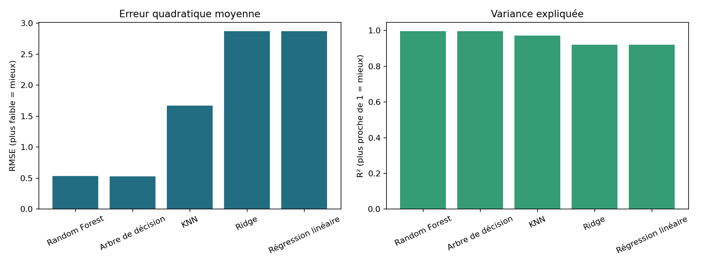

# Efficacité énergétique — prédire la charge de chauffage

**Projet Machine Learning · INSEA · Python & scikit-learn · régression supervisée**

Comparer cinq modèles pour estimer la charge de chauffage d’un bâtiment à partir de huit caractéristiques. Le jeu public **UCI Energy Efficiency** contient **768 configurations simulées** ; la cible est `Y1`. La cible de refroidissement `Y2` est exclue des prédicteurs.

**Équipe :** ELKIHEL ELMEHDI · EL ASSRI L’HOUCINE · SAID CHARAF. La partie présentée par L’Houcine porte sur le protocole d’évaluation et les modèles.

## Découvrir le projet

| Pour… | Ouvrir |
| --- | --- |
| Lire l’analyse et les résultats sans exécuter de code | [Notebook exécuté](Projet_03_Efficacite_Energetique.ipynb) |
| Comprendre la méthode | [Code d’entraînement](src/train.py) |
| Consulter la synthèse | [Rapport PDF](report/rapport.pdf) et [présentation](Presentation_Projet_03.pptx) |
| Vérifier les chiffres | [Métriques CSV](results/metrics.csv), [paramètres](results/parameters.json), [prédictions test](results/predictions_test.csv) |
| Approfondir le protocole et les modèles | [Guide de L’Houcine](guides/02_EL_ASSRI_Protocole_Modeles.md) |

## Méthode

- Séparation 80/20 : **614 observations d’entraînement**, **154 de test**.
- Régression linéaire comme référence ; Ridge, KNN, arbre de décision et Random Forest avec recherche d’hyperparamètres par validation croisée à cinq plis.
- Prétraitement dans des pipelines : encodage de `X6` et `X8`, standardisation pour les modèles sensibles à l’échelle.
- Choix des paramètres sur l’entraînement ; évaluation finale sur le test avec MAE, RMSE et R².

## Résultats enregistrés

| Modèle | RMSE moyen en validation croisée | RMSE test | R² test |
| --- | ---: | ---: | ---: |
| Random Forest | 0,5353 | 0,5359 | 0,9972 |
| Arbre de décision | 0,5791 | 0,5311 | 0,9973 |
| KNN | 1,5586 | 1,6712 | 0,9732 |
| Ridge | 2,8284 | 2,8735 | 0,9208 |
| Régression linéaire | 2,8285 | 2,8723 | 0,9209 |

Source : [results/metrics.csv](results/metrics.csv). Random Forest obtient le meilleur RMSE moyen en validation croisée ; l’arbre a un RMSE légèrement inférieur sur ce test. Le test ne sert pas à choisir les hyperparamètres.



## Reproduire l’analyse

```bash
git clone https://github.com/elassri538/insea-ml-energy-efficiency.git
cd insea-ml-energy-efficiency
python -m venv .venv
# Linux / macOS / WSL :
source .venv/bin/activate
# Windows PowerShell : .venv\Scripts\Activate.ps1
python -m pip install -r requirements.txt
python src/train.py
python make_notebook.py
```

Le notebook et les résultats sont déjà disponibles. Les commandes ci-dessus régénèrent les analyses ; elles n’ont pas été relancées pour cette mise à jour de présentation.

## Données et limites

[UCI Machine Learning Repository — Energy Efficiency](https://archive.ics.uci.edu/dataset/242/energy+efficiency). Il s’agit de simulations : les scores ne prouvent pas une performance équivalente sur des bâtiments réels. Une séparation aléatoire sur ce jeu ne mesure pas non plus la généralisation à toutes les familles de bâtiments.

## Documents et soutenance

Les [sources LaTeX](report/rapport.tex), [guides des trois membres](guides/) et [scripts oraux](scripts_oraux/) sont conservés. La présentation comprend huit diapositives avec notes orales. Les détails de régénération des documents restent dans le [guide des livrables](docs/DELIVERABLES.md).
